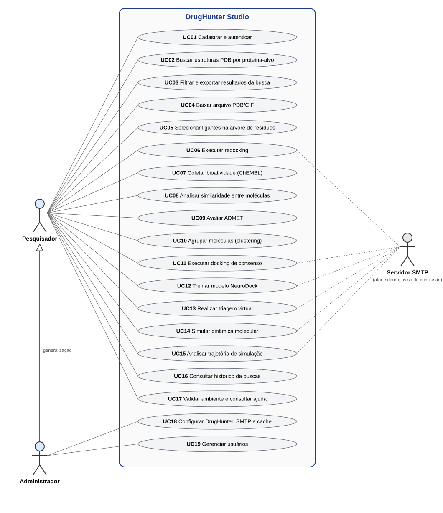

# Visão geral

## Problema

O DrugHunter cobre todo o fluxo de triagem virtual de fármacos (recuperação de dados, pré-análise, docking,
inteligência artificial e dinâmica molecular), porém **exige que o usuário seja programador**: não há CLI nem arquivo
de configuração central; cada etapa é um script de exemplo em `workflow/` cujos argumentos são editados à mão
(`DH/workflow/*/NN-*.py`). Pesquisadores de áreas como biologia e farmácia ficam, na prática, fora do alcance da ferramenta.

## Proposta

O Studio é uma **camada de acessibilidade** sobre o DrugHunter. Seus princípios de projeto:

1. **Interface, não motor** — o Studio não reimplementa análises científicas; chama o DrugHunter por subprocesso.
2. **Fidelidade ao fluxo original** — desvios do DrugHunter são mínimos, documentados e justificados.
3. **Mínimo de digitação e de decisões** — valores padrão sensatos, pré-preenchimento entre etapas, validação de ambiente.
4. **Portabilidade** — caminhos relativos, instalação com poucos passos (pacote `.deb` e instalador Windows).

!!! note "Estudo de caso"
    Para o TCC, a validação é feita escolhendo um fungo como organismo-alvo e percorrendo o pipeline do início ao
    fim pela interface. O redocking foi o primeiro fluxo funcional ponta a ponta.

## Atores

| Ator | Descrição |
|---|---|
| **Pesquisador** | Usuário-alvo: não programador. Executa buscas, jobs e analisa resultados. |
| **Administrador** | Pesquisador com permissões extras: configura caminhos do DrugHunter, SMTP, TTL do cache e gerencia usuários. O **primeiro usuário cadastrado** vira administrador automaticamente (`services/auth.py:34`). |
| **Servidor SMTP** | Sistema externo que envia o e-mail de conclusão de jobs longos. |
| **RCSB PDB / ChEMBL** | Fontes de dados externas. |

*Figura 1 — Contexto do sistema (C4, nível 1).*

## Casos de uso

*Figura 2 — Casos de uso do DrugHunter Studio (UML).*

| Código | Caso de uso | Rota no frontend | Módulo |
|---|---|---|---|
| UC01 | Cadastrar e autenticar | `/` | Autenticação |
| UC02 | Buscar estruturas PDB por proteína-alvo | `/busca-pdb` | Busca RCSB |
| UC03 | Filtrar e exportar resultados | `/busca-pdb` | Dashboard |
| UC04 | Baixar arquivo PDB/CIF | `/busca-pdb`, `/meus-pdbs` | Download |
| UC05 | Selecionar ligantes (árvore de resíduos) | `/visualizador/:pdb_id` | Visualizador |
| UC06 | Executar redocking | `/redocking` | Redocking |
| UC07 | Coletar bioatividade no ChEMBL | `/chembl` | ChEMBL |
| UC08 | Analisar similaridade entre moléculas | `/chembl/:jobId/resultados` | Análise molecular |
| UC09 | Avaliar ADMET | `/admet/:resultId` | ADMET |
| UC10 | Agrupar moléculas (clustering) | `/clustering/:jobId` | Clustering |
| UC11 | Executar docking de consenso | `/consensus/:jobId` | Consenso |
| UC12 | Treinar modelo NeuroDock | `/neurodock` | NeuroDock |
| UC13 | Realizar triagem virtual | `/neurodock/:modelId` | NeuroDock |
| UC14 | Simular dinâmica molecular | `/dinamica-molecular` | MD |
| UC15 | Analisar trajetória | `/dinamica-molecular/:jobId` | Análise MD |
| UC16 | Consultar histórico de buscas | `/busca-pdb`, `/historico/:id` | Histórico |
| UC17 | Validar ambiente e consultar ajuda | `/ajuda`, `/home` | Ajuda |
| UC18 | Configurar DrugHunter, SMTP e cache | `/configuracoes` | Administração |
| UC19 | Gerenciar usuários | `/configuracoes` | Administração |

## Requisitos funcionais

| ID | Requisito | Evidência |
|---|---|---|
| RF01 | Autenticar com e-mail ou nome de usuário; sessão por JWT (access 60 min, refresh 7 dias) | `core/security.py`, `usecases/auth.py` |
| RF02 | Buscar estruturas por proteína com progresso em tempo real e cache compartilhado | `routes/search.py`, SSE |
| RF03 | Filtrar por organismo, resolução, ligante; exportar CSV; baixar PDB/CIF individual ou em lote | `DashboardTemplate`, `hooks/useDashboard.ts` |
| RF04 | Navegar pela estrutura (átomos/ligantes/resíduos) e montar `pdb_codes.csv` | `ResidueTree`, `VisualizadorContext` |
| RF05 | Executar o pipeline CADD (redocking, ChEMBL, ADMET, clustering, consenso, NeuroDock, MD) como jobs assíncronos | módulos em [Fluxos](04-fluxos-e-modulos.md) |
| RF06 | Acompanhar status de cada job e ser avisado por e-mail na conclusão | polling + `email_sender.py` |
| RF07 | Visualizar resultados (tabelas, gráficos, estruturas 2D/3D) | [Frontend](06-frontend.md) |
| RF08 | Validar o ambiente do DrugHunter (caminhos, ferramentas) e orientar a correção | `GET /api/admin/validar-drughunter` |
| RF09 | Administrar usuários, cache (TTL) e SMTP | `routes/admin.py` |

## Requisitos não funcionais

| ID | Requisito | Situação atual |
|---|---|---|
| RNF01 | **Usabilidade** para não programadores (ISO 9241-11) | A validar — ver [Usabilidade](12-usabilidade.md) |
| RNF02 | **Acessibilidade** WCAG 2.2 AA | **Parcial** — ver [Acessibilidade](11-acessibilidade.md) |
| RNF03 | **Portabilidade** (Linux e Windows) | `.deb` e instalador NSIS; DrugHunter e ferramentas externas continuam pré-requisitos |
| RNF04 | **Desempenho**: interface não bloqueia durante jobs longos | Jobs em threads/subprocessos + polling |
| RNF05 | **Segurança**: autenticação, segredos criptografados, isolamento por usuário | JWT, Fernet para senha SMTP, jobs filtrados por `user_id` — ver [Segurança](08-implantacao-e-seguranca.md) |
| RNF06 | **Manutenibilidade**: camadas e baixo acoplamento | Hexagonal (backend) e camadas com DI manual (frontend) |
| RNF07 | **Testabilidade** | **Não atendido** — não há testes automatizados (ver [Limitações](14-limitacoes.md)) |

## Tecnologias

| Camada | Tecnologia |
|---|---|
| Frontend | React 18, TypeScript 5.9 (strict), Vite 5, Tailwind CSS 4, React Router 6, Recharts 2, NGL 2.5, smiles-drawer 2.4, PapaParse, Yup |
| Backend | Python, FastAPI, SQLAlchemy 2, Pydantic v2, python-jose (JWT), passlib/bcrypt, pandas |
| Banco | SQLite (WAL, `foreign_keys=ON`); PostgreSQL previsto para produção |
| Tempo real | Server-Sent Events (somente na busca PDB); polling nos demais módulos |
| Empacotamento | `.deb` (build.sh), NSIS (build-windows.sh) |
| Motor científico (externo) | DrugHunter: RDKit, AutoDock Vina, Dock6, UCSF Chimera, OpenMM, OpenBabel, PyMOL, TensorFlow/Keras, Optuna |
