# Arquitetura

A arquitetura é descrita no modelo **C4**: contexto → contêineres → componentes, complementado por
visões de camadas e de implantação. O C4 é hoje a notação mais usada no mercado para comunicar arquitetura a públicos
mistos (técnicos e não técnicos) e não exige conhecimento prévio de UML.

## Contexto (C4 nível 1)

Ver [Figura 1](01-visao-geral.md). O Studio fica entre o pesquisador e o DrugHunter; ele próprio acessa RCSB (busca e
download) e SMTP, enquanto o DrugHunter acessa o ChEMBL e as ferramentas de docking e simulação.

## Contêineres (C4 nível 2)

*Figura 3 — Contêineres do DrugHunter Studio (C4, nível 2).*

| Contêiner | Responsabilidade | Observações |
|---|---|---|
| **Frontend SPA** | Interface, estado de tela, polling de jobs, gráficos | Servido estático pelo backend em produção; em dev, Vite `:5173` com proxy `/api` → `:8000` |
| **Backend API** | Autenticação, regras de aplicação, persistência, orquestração de jobs | FastAPI; uma thread daemon por job (ver [padrão de job](04-fluxos-e-modulos.md#padrao-de-job)) |
| **SQLite** | 17 tabelas (usuários, cache de proteínas, jobs, resultados) | Criado por `create_all`; **sem Alembic** (migração manual idempotente em `_migrate_schema`) |
| **Workers** | Um script `_dh_*_worker.py` por módulo; importa o DrugHunter e reporta eventos JSON | Executados com o Python do ambiente conda do DrugHunter (`python_bin`) |
| **DrugHunter** | Motor científico | Diretório externo (`drug_hunter_path`); **não é empacotado nem modificado** |
| **Artefatos do pipeline** | CSV, PNG, modelos, trajetórias | Ficam **dentro do diretório do DrugHunter**, não na pasta de dados do Studio |

## Backend: arquitetura hexagonal

*Figura 4 — Camadas do backend (portas e adaptadores).*

A organização segue *Ports & Adapters*: `routes/` adapta HTTP para o domínio; `usecases/`
orquestra; `services/` são repositórios; `infra/` implementa adaptadores de saída (banco, runners externos, storage).

| Pasta | Papel | Regra |
|---|---|---|
| `routes/` | Handlers HTTP (12 routers) | Sem lógica de negócio |
| `core/` | `deps.py` (autenticação por dependência), `security.py` (JWT) | — |
| `usecases/` | Casos de uso; valida pré-requisitos e dispara jobs | Não conhece HTTP |
| `services/` | Consultas SQLAlchemy | Só conhecem `Session` e modelos |
| `domain/` | `models` (ORM), `schemas` (DTOs Pydantic), `utils` | Sem dependência de HTTP |
| `infra/` | `db`, `external` (runners e workers), `storage`, `scheduler`, `email_sender`, `crypto`, `pdb_preparador` | Implementações concretas |

!!! warning "Desvios da arquitetura declarada (observados no código)"
    - `routes/download.py`, `routes/home.py` e partes de `routes/clustering.py`/`neurodock.py` contêm lógica na própria rota
      (sem usecase), contrariando a regra "routes sem lógica".

## Frontend: camadas com injeção de dependência manual

*Figura 5 — Camadas do frontend.*

Fluxo real: **Page → hook `useXPage` → Template → componentes → UseCase → `IHTTPClient` → `fetch /api`**.
O `container.ts` instancia **um** `HTTPClient` e **16 usecases** como singletons; `App.tsx` os repassa por props até as
páginas. Detalhes em [Frontend](06-frontend.md).

## Implantação

*Figura 6 — Visões de implantação (desenvolvimento, Linux, Windows).*

Detalhes de empacotamento, localização dos dados e variáveis de ambiente em
[Implantação e segurança](08-implantacao-e-seguranca.md).

## Decisões arquiteturais relevantes

| Decisão | Justificativa | Consequência |
|---|---|---|
| Chamar o DrugHunter **por subprocesso** com o Python do ambiente conda dele | O DrugHunter exige um ambiente científico pesado (RDKit, OpenMM, TensorFlow…) incompatível com o ambiente do backend | Isolamento de dependências; comunicação por JSON em `argv` e JSON-lines no `stdout` |
| **Polling** em vez de WebSocket/SSE para jobs | Simplicidade; jobs duram minutos a horas | Latência de 2,5–10 s na atualização; falhas de rede podem passar despercebidas |
| **SSE** apenas na busca RCSB | Progresso fino por proteína; `EventSource` não envia cabeçalhos → token vai na *query string* | Ver [segurança](08-implantacao-e-seguranca.md#seguranca) |
| Artefatos dentro da árvore do DrugHunter | O DrugHunter só aceita caminhos relativos ao seu `cwd` | Acoplamento por convenção de pastas; apagar o diretório do DrugHunter apaga os resultados |
| Cache de proteínas **compartilhado** entre usuários | Reduz chamadas ao RCSB | `proteins` não tem `user_id`; TTL configurável limpa o cache |
| Estados de job como `String` livre | Simplicidade | Sem `Enum`/`CHECK`; valores só por convenção (`pending`, `running`, `done`, `error`, `cancelled`) |
