# Modelo de dados

O banco tem **17 tabelas** (SQLAlchemy 2; SQLite com `WAL` e `foreign_keys=ON`). Elas são criadas por
`Base.metadata.create_all` (`infra/db/database.py:119`); **não há ferramenta de migração** (Alembic), apenas
`_migrate_schema` (idempotente, `database.py:124-145`).

## Visão geral (relacionamentos)

*Figura 7 — Modelo entidade-relacionamento (notação pé-de-galinha). Linhas contínuas: chaves estrangeiras declaradas;
linhas tracejadas: relações **lógicas** sem FK. Todas as tabelas de job/resultado possuem também `user_id` → `users`
(omitido para legibilidade).*

## Usuários, busca e cache de proteínas

*Figura 8 — Entidades de usuário, busca no PDB e cache.*

| Tabela | Finalidade | Particularidades |
|---|---|---|
| `users` | Contas | `email` e `username` únicos. O primeiro usuário vira `is_admin`. |
| `proteins` | **Cache compartilhado** de estruturas | Sem `user_id`. Colunas de cache de arquivo (`pdb_file_cached`, `cif_file_cached`, `*_storage_key`). TTL por `ultima_consulta`. |
| `searches` | Histórico de buscas | `user_id` **anulável** (busca anônima). Apagadas após 30 dias (fixo no scheduler). |
| `search_results` | N:N busca × proteína | `UNIQUE(search_id, protein_id)`; `CASCADE` |
| `user_pdb_downloads` | N:N usuário × proteína, com `formato` (`legacy`/`cif`) | `UNIQUE(user_id, protein_id, formato)`. **É a base da autorização do visualizador.** |
| `user_pdb_csv` | `pdb_codes.csv` corrente do usuário (relação 1:1) | `user_id` único; sobrescrito com o CSV contendo RMSD ao fim do redocking |
| `system_config` | Configuração global chave/valor | `smtp_password` armazenada **criptografada** (Fernet). Chaves: `ttl_dias`, `max_por_proteina`, `limpeza_automatica`, `drug_hunter_path`, `python_bin`, `chimera_path`, `dock6_path`, `smtp_*` |

## Jobs e resultados do pipeline

*Figura 9 — Cadeia ChEMBL → ADMET → Clustering/Consenso.*

*Figura 10 — Cadeia NeuroDock, dinâmica molecular e redocking.*

### Restrições de unicidade que definem o comportamento de "re-executar"

| Restrição | Efeito |
|---|---|
| `admet_results`: `UNIQUE(user_id, chembl_job_item_id)` | Um ADMET por item ChEMBL por usuário; rodar de novo **sobrescreve** |
| `clustering_jobs`: `UNIQUE(user_id, admet_result_id, fingerprint_type, max_mols)` | Um clustering por combinação; como `max_mols` pode ser `NULL` (e `UNIQUE` não bloqueia `NULL` em SQL), o *service* deduplica por consulta (`services/clustering.py:27-38`) |
| `consensus_jobs`: `UNIQUE(user_id, admet_result_id)` | No máximo um consenso por ADMET |
| `neurodock_models`: `UNIQUE(user_id, clustering_job_id)` | Um modelo por clustering |

### Comportamento de remoção (`ondelete`)

| Relação | Regra |
|---|---|
| `users` → jobs e resultados | `CASCADE` (exceto `chembl_jobs.user_id`: `SET NULL`) |
| `chembl_job_items` → `admet_results`, `admet_results` → `clustering_jobs`/`consensus_jobs`, `clustering_jobs` → `neurodock_models`, `consensus_jobs` → `md_jobs` | `SET NULL` |
| `neurodock_models` → `neurodock_predictions`, `md_jobs` → `md_analysis_jobs` | `CASCADE` |

Além disso, existem **cascatas aplicativas** (feitas no código, não no banco) que também apagam arquivos: apagar um job
ChEMBL remove ADMET → Consenso → Clustering → NeuroDock e as pastas correspondentes (`usecases/chembl.py:117-179`);
re-executar clustering apaga o modelo NeuroDock dependente; retreinar apaga as predições.

### Relações lógicas (sem chave estrangeira)

O acoplamento entre vários módulos é feito por **convenção de nomes e pastas**, não pelo banco:

| Relação | Mecanismo | Risco |
|---|---|---|
| Redocking ↔ Consenso | Mesma pasta `base_input_path/target`; a UI pré-preenche pdb_id/ligante a partir do redocking | O backend **não valida** que o redocking foi feito |
| Consenso ↔ NeuroDock | Busca por `(user_id, admet_result_id, status="done")` | Sem FK; dependência implícita |
| `ChemblJobItem.folder_name` = `ClusteringJob.target` = `ConsensusJob.target` | Nome da pasta | Renomear quebra a ligação |
| `MDJob.target` ↔ `datasets/PDB/{target}/Prepared/` | Texto livre | — |
| `Protein.*_storage_key` ↔ arquivo em `PDB_FILES_DIR` | Chave no disco | Arquivo pode sumir sem o banco saber |

### Inconsistências de nomenclatura (dívida técnica)

`redocking_jobs` usa `erro_msg`, `iniciado_em`, `finalizado_em` (pt-BR), enquanto os demais usam `error_msg`,
`created_at`, `finished_at`. Os estados são `String(20)` livres, sem `Enum` nem `CHECK`.

## Dicionário de dados (colunas-chave)

| Tabela.coluna | Tipo | Descrição |
|---|---|---|
| `proteins.resolucao` | Float | Resolução cristalográfica em Å (menor = melhor); `NULL` para NMR/EM sem valor |
| `proteins.tem_ligante` | Bool | Há entidade não polimérica na estrutura |
| `user_pdb_downloads.formato` | String(10) | `legacy` (.pdb) ou `cif` (.cif) |
| `chembl_job_items.*_filters` | Text (JSON) | Filtros de cada etapa do ChEMBL (alvo, bioatividade, molécula, similares) |
| `admet_results.bbb_plus` / `hia_plus` / `pgp_plus` | Int | Contagens de moléculas com permeabilidade BBB / absorção HIA / substrato P-gp |
| `clustering_jobs.silhouette_score` | Float | Coeficiente de silhueta (−1 a 1; mais próximo de 1 = melhor separação) |
| `consensus_jobs.selected_categories` | Text (JSON) | Categorias ADMET usadas como entrada (`bbb_plus`, `bbb_minus`, `hia_plus`, `toxic`, `all`) |
| `neurodock_models.consensus_type` | String | `min-max` ou `z-score` — variável-alvo do modelo |
| `neurodock_predictions.top_k` | Int | Quantidade de moléculas selecionadas na triagem |
| `md_jobs.params_json` | Text (JSON) | Parâmetros da simulação (campo de força, temperatura, duração…) |
