# Fluxos e módulos

## Pipeline ponta a ponta

*Figura 11 — Fluxo geral do estudo de caso: do alvo à dinâmica molecular.*

O pesquisador percorre cinco etapas: (1) escolher o alvo e as estruturas; (2) validar o protocolo de docking por
redocking; (3) reunir e filtrar moléculas candidatas; (4) triar por clustering, docking de consenso e rede neural;
(5) confirmar por dinâmica molecular.

## Dependências entre módulos

*Figura 12 — Dependências exigidas pelo código (setas grossas) e lógicas (tracejadas).*

| Dependência | Tipo | Evidência |
|---|---|---|
| ChEMBL → ADMET | FK + `status == "done"` | `usecases/admet.py:151` |
| ADMET → Clustering | FK + `done` | `usecases/clustering.py:168` |
| ADMET → Consenso | FK + `done` | `usecases/consensus.py:273` |
| Clustering **e** Consenso → NeuroDock (treino) | FK (clustering) + busca por `admet_result_id` (consenso) | `usecases/neurodock.py:136-153` |
| NeuroDock (modelo) → Triagem | `done` | `usecases/neurodock.py:307` |
| Consenso → MD | FK + `done` (receptor `dh_prepared`) | `usecases/molecular_dynamics.py:163` |
| MD → Análise de trajetória | FK + `done` | `usecases/molecular_dynamics.py:330` |
| Redocking → Consenso / MD | **Apenas convenção de pastas** | Sem validação no backend |

## Padrão de job

ADMET, clustering, consenso, NeuroDock e MD seguem o mesmo padrão (thread daemon + worker + polling). Variações:
o **ChEMBL** usa `asyncio.create_task`; o **redocking** usa `BackgroundTasks` + `subprocess.run` (síncrono); a
**busca PDB** não usa job (streaming SSE).

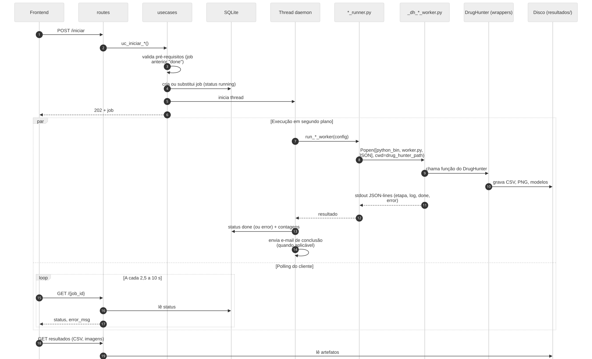
*Figura 13 — Padrão genérico de execução de job (sequência).*

**Protocolo runner ↔ worker.** O runner dispara `python_bin _dh_X_worker.py '<JSON>'` com `cwd = drug_hunter_path`.
O worker insere `DH/src` no `sys.path`, faz `os.chdir` e chama a função do DrugHunter. O progresso volta pelo `stdout`
em **JSON-lines** (`{"type": "etapa|start|log|warn|done|error", ...}`).

### Estados

*Figura 14 — Ciclo de vida de um job (inclui o estado terminal `cancelled`).*

!!! note "Recuperação após reinício do servidor"
    Se o servidor reiniciar com um job em `running`, ChEMBL, clustering, consenso, NeuroDock e MD são recuperados no
    próximo `GET`; **redocking, ADMET e análise MD permanecem em `running`** — nesses casos o usuário pode usar
    **Cancelar** para liberar o job.

### Mecanismo de progresso por módulo

| Módulo | Execução | Progresso para a UI | Intervalo de polling |
|---|---|---|---|
| Busca PDB | `async generator` | **SSE** (`EventSource`) | tempo real |
| Redocking | `BackgroundTasks` + `subprocess.run` | só `status` | 10 s |
| ChEMBL | `asyncio.create_task` + `create_subprocess_exec` | status do item + etapa inferida pelos arquivos | 3 s |
| Análise molecular | `BackgroundTasks` + `Popen` | estado inferido do disco | 5 s |
| ADMET | thread daemon | `status` | 2,5 s |
| Clustering | thread daemon | `status` | 4 s |
| Consenso | thread daemon | `status` | 4 s |
| NeuroDock | thread daemon | `status` | 8 s (modelo) / 5 s (predição) |
| Dinâmica molecular | thread daemon | `status` | 10 s |

## Cancelamento de jobs

Qualquer job `pending` ou `running` pode ser cancelado pelo usuário, em todos os módulos (redocking, ChEMBL, ADMET,
clustering, consenso, NeuroDock — treino e triagem —, dinâmica molecular e análise de trajetória). Na interface, o
botão **Cancelar** aparece ao lado do indicador de progresso e pede confirmação; ao final, a tela mostra um cartão
neutro "Processamento cancelado" com a opção de **rodar novamente**.

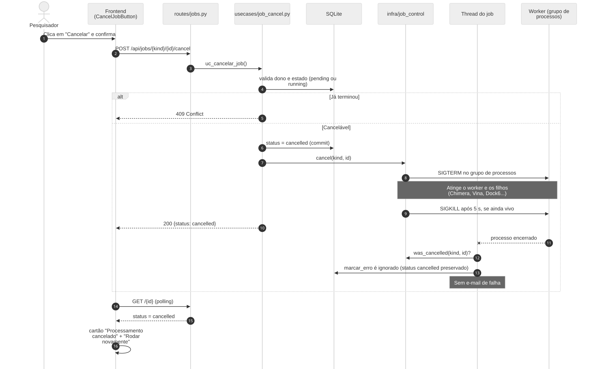
*Figura 14b — Cancelamento de um job em andamento.*

**Como funciona** (`infra/job_control.py`, `usecases/job_cancel.py`, `routes/jobs.py`):

| Aspecto | Decisão |
|---|---|
| Endpoint | Único para todos os módulos: `POST /api/jobs/{kind}/{id}/cancel` (200; 404 se não existe ou é de outro usuário; 409 se já terminou) |
| Estado | Novo estado terminal **`cancelled`**, distinto de `error`: cancelar não é falha (sem e-mail de erro) |
| Encerramento | O subprocesso do worker é criado em **grupo de processos próprio**; o cancelamento envia `SIGTERM` ao grupo inteiro (worker e filhos: Chimera, Vina, Dock6…) e `SIGKILL` após 5 s. No Windows, usa `taskkill /T` |
| Ordem | Primeiro grava `cancelled` no banco, depois encerra o processo. Assim, o worker que termina em seguida não consegue gravar `error` por cima (os `marcar_*` dos *services* preservam `cancelled`) |
| Sessão da thread | A thread do job mantém uma sessão de banco longa, com o objeto do job em cache; por isso cada `marcar_*` **relê o estado do banco** (`populate_existing`) antes de checar `cancelled`. Sem isso, o worker enxergaria o estado antigo (`running`) e gravaria `error` por cima do cancelamento |
| ChEMBL | Cancela o grupo inteiro: o item em execução é interrompido e os itens restantes não são iniciados |
| Exclusão | Excluir um job em andamento (`DELETE`) também encerra o processo |
| Proteção | Se um runner não tiver criado grupo próprio, o sistema nunca usa `killpg` (derrubaria o servidor); usa `terminate()` |

!!! info "Limites"
    O registro de processos vive na memória do servidor: após um reinício, subprocessos antigos já não são
    conhecidos. A **análise molecular** do ChEMBL (consolidação, fingerprints e grafos) roda à parte da coleta e
    **não** tem cancelamento: cancelar o job ChEMBL interrompe só a coleta.

## 1. Autenticação

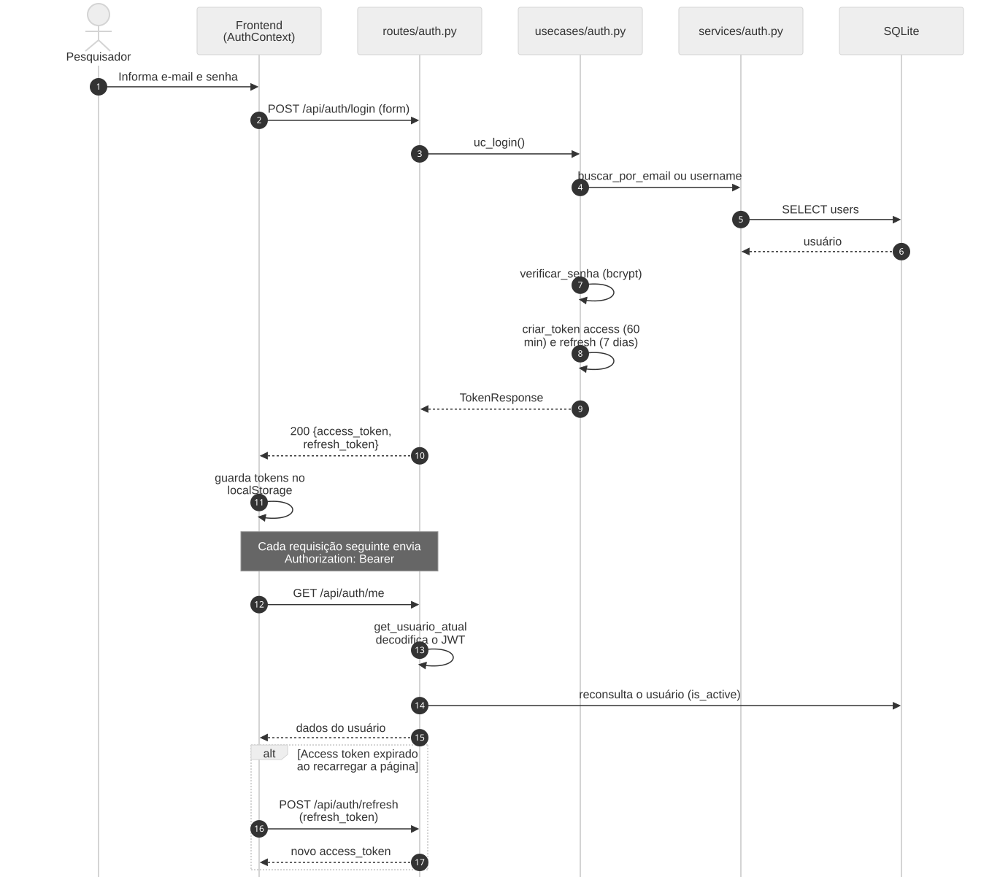
*Figura 15 — Login, sessão e renovação do token.*

Tokens JWT HS256: *access* (60 min) e *refresh* (7 dias), guardados no `localStorage`. Não há revogação. O
`get_usuario_atual` reconsulta o usuário a cada requisição e recusa contas desativadas.

## 2. Busca de estruturas (RCSB)

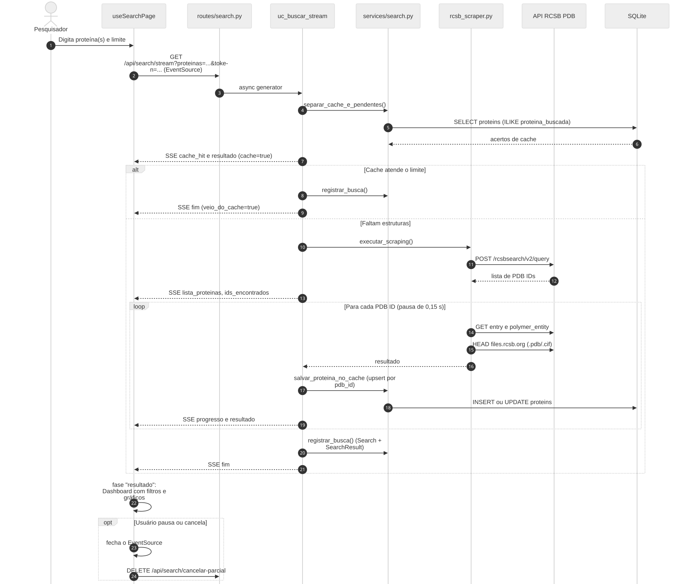
*Figura 16 — Busca por proteína com streaming SSE e cache.*

*Figura 17 — Estados da tela de busca.*

Consulta primeiro o cache (`proteins`, `ILIKE` em `proteina_buscada`); só vai ao RCSB para completar o `limite`.
O scraper usa `urllib` e uma pausa de 0,15 s por estrutura. **Não usa o DrugHunter** (reimplementação deliberada).

## 3. Download e visualizador

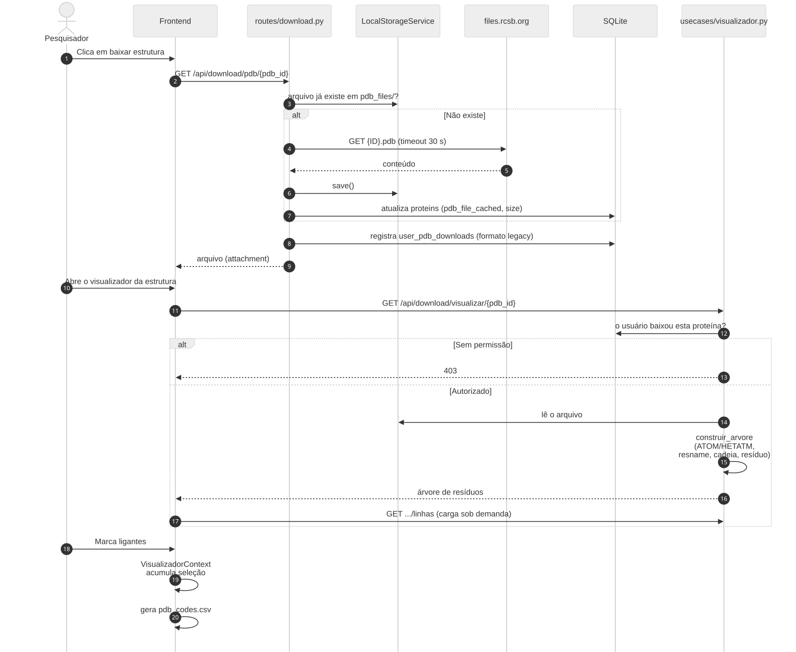
*Figura 18 — Download de PDB/CIF e navegação pela estrutura.*

A autorização do visualizador é feita pela existência de `user_pdb_downloads` para o usuário. O visualizador é uma
**árvore de resíduos** (ATOM/HETATM → nome do resíduo → cadeia+número), não uma visão 3D; a seleção alimenta o
`pdb_codes.csv` usado no redocking.

## 4. Redocking

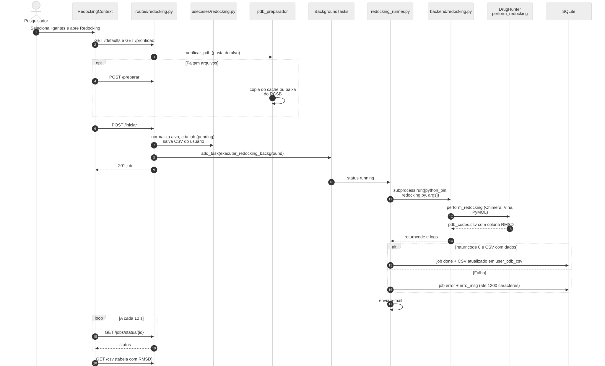
*Figura 19 — Redocking: preparação, execução e coleta do RMSD.*

O redocking valida o protocolo: reencaixa o ligante cristalográfico no receptor e mede o **RMSD** entre a pose
prevista e a experimental. O sucesso exige `returncode == 0` **e** `pdb_codes.csv` com a coluna RMSD preenchida
(`infra/redocking_runner.py:178`). O CSV com RMSD volta para `user_pdb_csv`.

## 5. ChEMBL e análise molecular

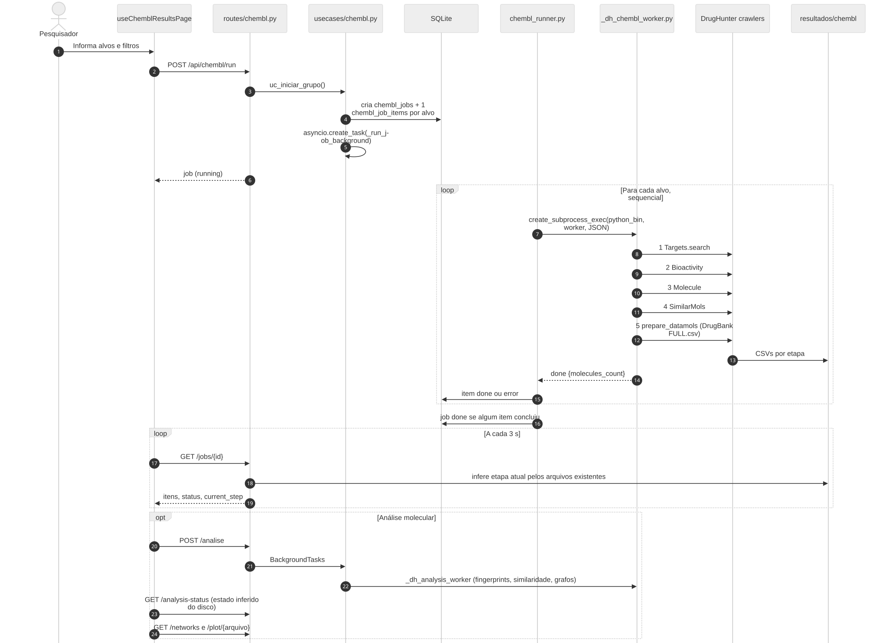
*Figura 20 — Coleta de bioatividade em cinco etapas, por alvo, e análise molecular.*

Os alvos de um grupo rodam **sequencialmente**, cada um em um subprocesso. Os eventos SSE emitidos pelo runner são
**descartados** pelo usecase (`usecases/chembl.py:413-423`): a UI só vê o estado gravado no banco. A etapa corrente é
**inferida pelos arquivos** existentes em disco.

## 6. ADMET e clustering

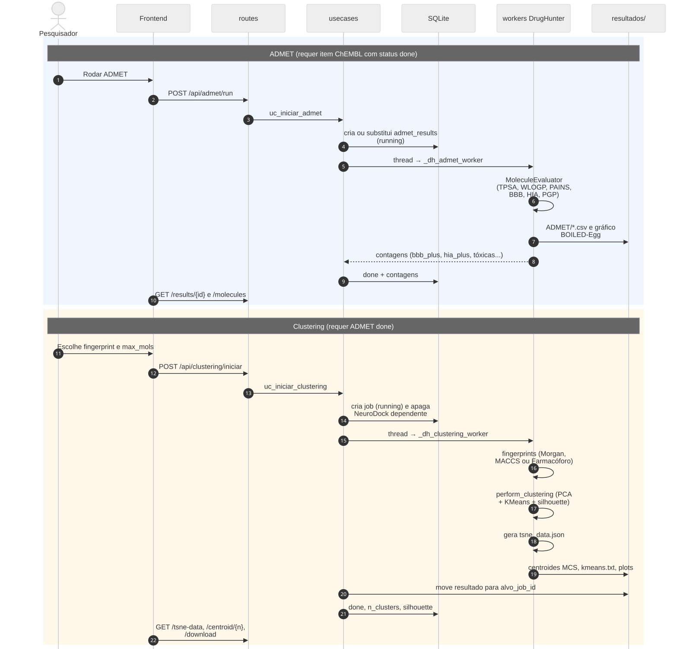
*Figura 21 — ADMET (heurístico) e clustering (PCA + KMeans).*

O ADMET é **heurístico**, não aprendizado de máquina: TPSA, WLOGP, MW, HBD/HBA, regras PAINS, SMARTS de
mutagenicidade/tumorigenicidade e elipses do modelo BOILED-Egg para BBB e HIA. O clustering usa fingerprints
(Morgan, MACCS ou farmacóforo), PCA em 4 componentes, KMeans com *k* escolhido pelo método do cotovelo e silhueta.

## 7. Docking de consenso

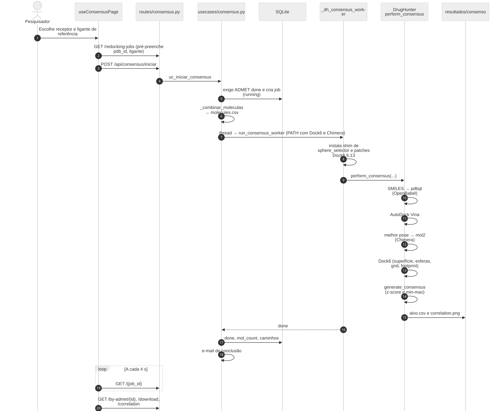
*Figura 22 — Docking de consenso Vina + Dock6.*

Cada molécula é encaixada em **dois programas** (AutoDock Vina e Dock6); os escores são normalizados e combinados
(**z-score** e **min-max**) para reduzir o viés de cada função de pontuação. A saída é `alvo.csv` ordenado e um
gráfico de correlação Vina × Dock6.

## 8. NeuroDock (treino e triagem virtual)

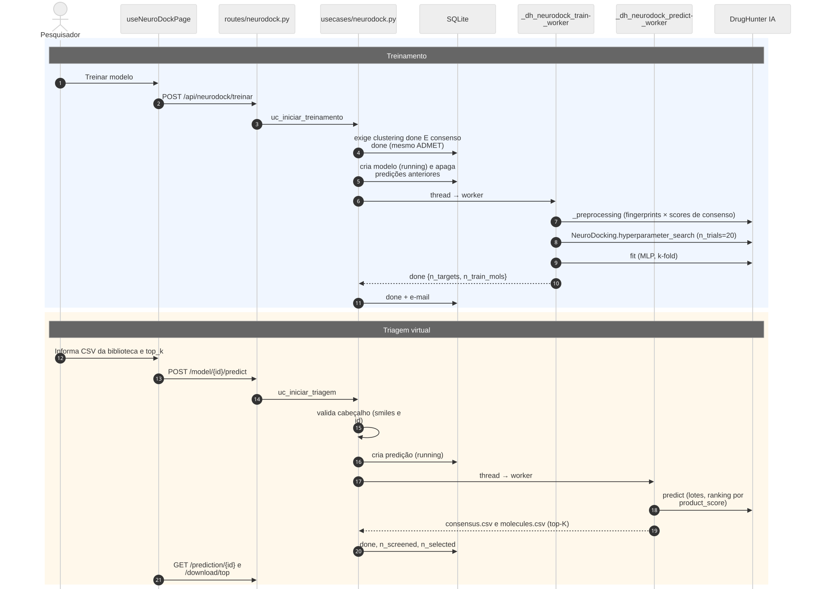
*Figura 23 — Treino do modelo e triagem de biblioteca.*

O NeuroDock é um **MLP** (Keras) que aprende a prever o escore de consenso a partir do *fingerprint* da molécula, com
busca de hiperparâmetros por Optuna (`n_trials`=20 por padrão no usecase; **a confirmar** o padrão do schema) e validação cruzada k-fold. Depois do
treino, triagem de uma biblioteca grande custa apenas inferência, em vez de docking real; as moléculas melhor
ranqueadas (`product_score`) podem voltar ao docking de consenso.

## 9. Dinâmica molecular e análise

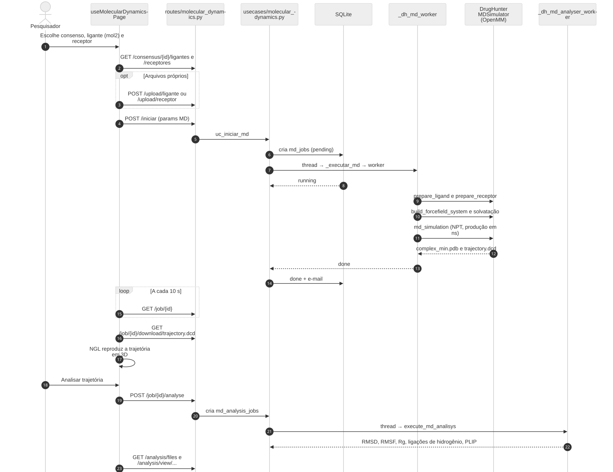
*Figura 24 — Simulação (OpenMM) e análise de trajetória.*

Preparação do ligante e do receptor, campo de força AMBER ff14SB + TIP3P (+ OpenFF 2.2.0 para o ligante), NPT a
310 K, passo de 2 fs e produção de 50 ns por padrão (valores do DrugHunter, ajustáveis na interface). A análise
calcula RMSD, RMSF, raio de giração e ligações de hidrogênio, e gera visualização interativa (PLIP).

## Fluxo de dados (DFD)

*Figura 25 — Diagrama de fluxo de dados (níveis 0–1 combinados).*
