# Integração com o DrugHunter

## O que é o DrugHunter

Biblioteca Python de CADD (*computer-aided drug design*) para triagem virtual de alto desempenho. Não tem CLI
nem configuração central: cada etapa do `workflow/` é um **script de exemplo** com argumentos fixos no código,
executado com o *cwd* na raiz do DrugHunter.

*Figura 26 — Estrutura do DrugHunter: scripts do `workflow/` com seus artefatos, e camadas de `src/`.*

| Etapa (`workflow/`) | O que faz | Ferramentas |
|---|---|---|
| 1-InformationRetrieval | PDB (`rcsbsearchapi`), ChEMBL (5 etapas), ZINC | `chembl_webresource_client` |
| 2-Preprocessing | Fingerprints, similaridade, grafos (maior componente conexo, MCS); filtro DataWarrior (manual); ADMET | RDKit, NetworkX, DataWarrior |
| 3-Docking | Redocking e docking de consenso (Vina + Dock6) | UCSF Chimera, AutoDock Vina, Dock6, OpenBabel, PyMOL |
| 4-MAIA | Clustering e NeuroDock (IA) | scikit-learn, TensorFlow/Keras, Optuna |
| 5-MolecularDynamics | Simulação e análise | OpenMM, OpenFF, AmberTools, MDAnalysis, PLIP |

### Convenção de caminhos (restrição que molda a integração)

O DrugHunter usa **caminhos "relativos ao cwd com barra inicial"** (ex.: `'/datasets/PDB'`) e concatena
`Path.cwd() + path`. Um caminho absoluto real quebra. Por isso o Studio: (i) executa sempre com `cwd = drug_hunter_path`;
(ii) grava os artefatos **dentro** da árvore do DrugHunter; (iii) converte caminhos absolutos em DH-relativos
(`_to_dh_rel`).

## Mapeamento Studio → DrugHunter

*Figura 27 — Função do DrugHunter chamada por cada módulo do Studio.*

| Módulo do Studio | Worker/runner | Delega ao DrugHunter | Adaptações do Studio |
|---|---|---|---|
| Busca PDB | `rcsb_scraper.py` | — | **Reimplementa** com a API do RCSB (não usa `11-pdb.py`) |
| ChEMBL | `_dh_chembl_worker.py` | `Targets`, `Bioactivity`, `Molecule`, `SimilarMols`, `prepare_datamols` | Chama as classes em vez de `load_chembl` para controlar caminhos; ajusta filtros (`type__in`→`target_type`, etc.); detecta falha silenciosa por `_FULL.csv` |
| Análise molecular | `_dh_analysis_worker.py` | `generate_fingerprints`, `compute_similarity`, `analyze_graphs` | Consolida `_MOLS`/`_SIMS`; detecta falha parcial do MCS |
| ADMET | `_dh_admet_worker.py` | `MoleculeEvaluator`, `BoiledEggPlotter` | Injeta *stub* de `kernel.header_builder` (ausente no DH); exportações `_BBB±`, `_HIA+`, `_toxic.csv` |
| Clustering | `_dh_clustering_worker.py` | `perform_clustering` | Calcula fingerprints se faltarem; limita `max_mols`; gera `tsne_data.json` próprio |
| Redocking | `backend/redocking.py` | `perform_redocking` | Monta `PATH` com `obabel`, `vina`, Chimera, Dock6; valida artefatos e logs |
| Consenso | `_dh_consensus_worker.py` | `perform_consensus` | *Shim* de `sphere_selector` (interativo no Dock6); *patch* de parâmetros do Dock6 6.13; limita paralelismo por RAM |
| NeuroDock treino | `_dh_neurodock_train_worker.py` | `_preprocessing`, `NeuroDocking` | `n_trials` configurável |
| NeuroDock triagem | `_dh_neurodock_predict_worker.py` | `predict` | Copia a biblioteca CSV para dentro do DH |
| MD | `_dh_md_worker.py` | `MDSimulator` (OpenMM) | Não usa `execute_md_simulation`; *patches* de `pkg_resources`, mol2→sdf, AM1-BCC→MMFF94 |
| Análise MD | `_dh_md_analyser_worker.py` | `execute_md_analisys` | Só adapta caminhos |

**Resumo.** O Studio **reimplementa**: busca/download PDB, consolidação MOLS/SIMS, parte do ADMET, t-SNE interativo,
`sphere_selector`. Ele **delega integralmente**: crawlers ChEMBL, fingerprints/similaridade/grafos, KMeans, redocking,
consenso Vina+Dock6, treino/predição do NeuroDock, MD e análise. **Não cobre**: ZINC (`13-zinc`), filtro DataWarrior
(`22`), SOM, uso de footprints como entrada de IA.

## Divergências e defeitos encontrados no DrugHunter

Registrados porque explicam código de compatibilidade do Studio e são pontos de atenção para a defesa do TCC:

| Achado | Impacto |
|---|---|
| `kernel/header_builder.py` não existe, mas `caad/admet.py` o importa | ADMET do DH falha com `ImportError`; o Studio injeta um *stub* |
| Dock6 6.13 renomeou parâmetros (`num_final_scored_poses`, `num_preclustered_conformers`) | Studio aplica *patch* em tempo de execução |
| `perform_consensus` com `pdb_code=None` interrompe e pede refino manual de *loops* no Chimera (`exit(1)`) | Studio contorna passando `pdb_code` explícito |
| `42-neurodock.py` tem `exit(1)` após `build_model` | Código posterior é inalcançável (exemplo) |
| `13-zinc.py` não bate com a assinatura de `load_zinc` | Exemplo desatualizado |
| Conflito `bson` × `pymongo` | Studio oferece correção (`POST /api/admin/corrigir-bson`) |
| `rdFMCS` sem *timeout* | Pode travar o clustering em moléculas difíceis |

## Princípios de manutenção da integração

Regras adotadas no projeto: **jamais modificar o DrugHunter**; qualquer desvio é
documentado e justificado; *workarounds* ficam nos workers do Studio. Isso preserva a possibilidade de atualizar o
DrugHunter sem *fork*.
