# Frontend

## Estrutura

Camadas e injeção de dependência: ver [Figura 5](02-arquitetura.md#frontend-camadas-com-injecao-de-dependencia-manual).

| Pasta | Conteúdo |
|---|---|
| `pages/XPage/` | `XPage.tsx` (fino) + `useXPage.ts` (estado, polling, navegação) |
| `templates/` | Renderização completa de cada tela (os maiores: MD 1988 linhas, NeuroDock 1070, Ajuda 1061) |
| `components/` | `ui` (Button, Card, Modal…), `layout` (navbar e dropdown no padrão *compound component*), `charts`, `icons` e componentes por módulo |
| `contexts/` | Auth, Theme, Redocking, Visualizador |
| `data/usecases` e `data/adapters` | Implementações das interfaces e transformação de dados para gráficos/tabelas |
| `domain/` | Interfaces `IXUseCase` e modelos |
| `infra/http` | `HTTPClient` (`fetch` + `Authorization: Bearer`; erro HTTP → `HttpError`) |

*Figura 28 — Diagrama de classes (recorte): interfaces, implementações e container de DI.*

## Navegação e rotas

*Figura 29 — Mapa de navegação. Todas as rotas são protegidas por `RotaProtegida`, exceto `/`.*

| Rota | Tela | Fonte de dados |
|---|---|---|
| `/` | Login/cadastro | `AuthContext` |
| `/home` | Painel: módulos, estado do ambiente (DrugHunter/Python/SMTP), últimas atividades | `GET /api/home/status` |
| `/busca-pdb` | Busca, progresso, dashboard e histórico | SSE + histórico |
| `/historico/:id` | Dashboard de uma busca salva | `historyUseCase` |
| `/meus-pdbs` | Arquivos baixados | `GET /api/download/meus-pdbs` |
| `/visualizador/:pdb_id`, `/visualizador-cif/:pdb_id` | Árvore de resíduos | `/api/download/visualizar*` |
| `/redocking` | Preparação, execução e resultados | `RedockingContext` |
| `/chembl`, `/chembl/:jobId/resultados` | Coleta e resultados | polling 3 s |
| `/admet`, `/admet/:resultId` | Resultados ADMET | polling 2,5 s |
| `/consensus`, `/consensus/:jobId` | Docking de consenso | polling 4 s |
| `/clustering`, `/clustering/:jobId` | Clustering | polling 4 s |
| `/neurodock`, `/neurodock/:modelId`, `…/prediction/:predId` | Treino e triagem | polling 8 s / 5 s |
| `/dinamica-molecular`, `/:jobId` | MD e análise | polling 10 s |
| `/configuracoes` (admin), `/ajuda` | Administração e ajuda | `/api/admin/*` |

## Contextos de estado global

| Contexto | Estado | Observação |
|---|---|---|
| `AuthContext` | `user`, `loading`; tokens no `localStorage` | Renova o token ao carregar a página |
| `ThemeContext` | `dark` \| `light` em `localStorage`; aplica `data-theme` | **Não** segue `prefers-color-scheme`; padrão escuro |
| `RedockingContext` | Job ativo, CSV em memória | Global para o job **sobreviver à navegação**; polling 10 s; renova token em 401 |
| `VisualizadorContext` | Seleção acumulada de ligantes entre vários PDBs | Só em memória; alimenta o `pdb_codes.csv` |

## Visualizações de dados

Resumo (a justificativa de cada escolha está em [Visualização de dados](13-visualizacao-de-dados.md)):

| Visualização | Biblioteca | Tela |
|---|---|---|
| Barras de resolução por faixa | Recharts | Dashboard de busca, Redocking |
| Barras de método experimental | Recharts | Dashboard de busca |
| Barras de estruturas por proteína | Recharts | Dashboard (≥ 2 proteínas) |
| Donut de ligantes (top-8) | Recharts | Redocking |
| **BOILED-Egg** (TPSA × WLOGP) | Recharts + SVG | ADMET |
| **t-SNE** por cluster | Recharts | Clustering |
| Correlação Vina × Dock6 (min-max e z-score) | SVG artesanal | Consenso |
| *Sparkline* de energia e temperatura | SVG artesanal | Dinâmica molecular |
| Trajetória 3D (cartoon + ligante) | NGL | Dinâmica molecular |
| Estrutura 2D da molécula | smiles-drawer (canvas) | ChEMBL, ADMET, NeuroDock |
| Rede de similaridade, curvas de treino, RMSD/RMSF/Rg/H-bonds, centroides MCS | Imagens PNG geradas pelo DrugHunter | ChEMBL, NeuroDock, MD, Clustering |
| Cartões-resumo (KPIs) e tabelas com filtros | Componentes próprios | Todos |

!!! note "Não existem"
    Heatmap e grafo interativo no cliente. A "rede" do ChEMBL é um PNG. O NGL só é usado na dinâmica molecular; o
    visualizador de PDB é uma árvore, não uma cena 3D.

## Tratamento de erros e feedback

- **Erros de job**: `status="error"` → cartão vermelho com `error_msg` e botão "Tentar novamente".
- **Erros de rede durante polling**: capturados em silêncio (`catch {}`) em quase todos os hooks; **não há aviso nem limite de tentativas**.
- **Toasts**: usados em Config, Redocking, Dashboard e painel acumulado; cada hook reimplementa `showToast` (4 s).
- **`alert()` nativo** em `useConsensusPage.ts:328` e `useNeuroDockPage.ts:484`.
- **401**: não há tratamento global; só `AuthContext` (ao carregar) e `RedockingContext` renovam o token. `services/api.ts` tem `fetchWithAuth` com refresh, mas é **código morto**.
