# Estratégia de validação

Esta seção responde, para o TCC, três perguntas: **o sistema é acessível? é usável por quem não programa? os
gráficos escolhidos são adequados ao que se quer mostrar?** Cada uma tem um método reconhecido, e juntas formam o
protocolo abaixo.

*Figura 30 — Metodologia de validação em quatro fases.*

## Como o mercado faz

| Pergunta | Prática de mercado | Padrão/norma de referência |
|---|---|---|
| Acessibilidade | Verificação **automática** (axe, Lighthouse) + **manual** (teclado, leitor de tela) + checklist por critério | **WCAG 2.2 nível AA** (W3C); norma europeia EN 301 549; no Brasil, eMAG e a Lei Brasileira de Inclusão (Lei 13.146/2015) |
| Usabilidade | **Teste com usuários** (tarefas guiadas, pensar em voz alta), **SUS**, avaliação heurística | **ISO 9241-11** (eficácia, eficiência, satisfação); 10 heurísticas de Nielsen |
| Visualizações | Revisão por **tipologia de tarefa e canal visual**, convenção da área, teste com usuários | Teoria de percepção visual e tipologia de tarefas de visualização |

## Mapa: o que validar, como, e onde está no projeto

| Atributo (ISO/IEC 25010) | Método | Instrumento | Evidência a produzir | Documento |
|---|---|---|---|---|
| Acessibilidade | Verificação WCAG 2.2 AA no navegador | Ferramentas do navegador, teclado | Registro das telas e do resultado | [Acessibilidade](11-acessibilidade.md) |
| Usabilidade — eficácia/eficiência | Teste com usuários | Tarefas T1–T7, cronômetro, taxa de sucesso | Média de sucesso e tempo por tarefa | [Usabilidade](12-usabilidade.md) |
| Usabilidade — satisfação | Questionário | **SUS** | Pontuação 0–100 | [Usabilidade](12-usabilidade.md) |
| Adequação das visualizações | Revisão + teste | Matriz dado → gráfico + perguntas no teste | Matriz justificada | [Visualização](13-visualizacao-de-dados.md) |

## Escopo e decisões

- **Testes automatizados (unidade, integração, ponta a ponta) estão fora do escopo deste trabalho.** A validação é
  feita por acessibilidade, usabilidade, adequação das visualizações e pelo **estudo de caso** (percorrer o pipeline
  do início ao fim pela interface com um organismo-alvo).
- **Acessibilidade**: a verificação no navegador foi realizada pela autora e considerada satisfatória
  (ver [Acessibilidade](11-acessibilidade.md)).
- **Visualizações**: a revisão apontou um gráfico inadequado (donut de ligantes), **substituído** por barras
  ordenadas; o t-SNE foi **mantido** como está por seguir o padrão do DrugHunter (ver
  [Visualização de dados](13-visualizacao-de-dados.md)).
- **Controle dos jobs**: a revisão heurística apontou a falta de cancelamento (controle e liberdade do usuário); os
  jobs agora podem ser cancelados (ver [Fluxos e módulos](04-fluxos-e-modulos.md#cancelamento-de-jobs)).

## Ordem sugerida de execução

1. Registrar a verificação de acessibilidade (telas avaliadas e resultado).
2. Conduzir o teste de usabilidade com 5–8 pessoas, com a interface já ajustada.
3. Aplicar o SUS ao final de cada sessão.
4. Fechar a matriz de visualizações com as respostas dos participantes.
5. Relatar limitações e ameaças à validade ([Limitações](14-limitacoes.md)).
